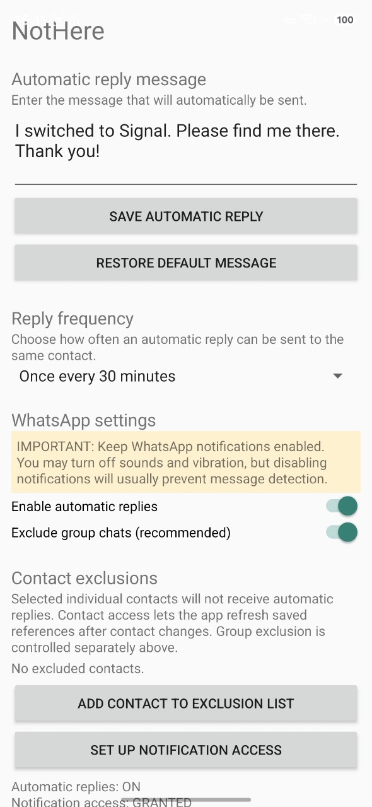
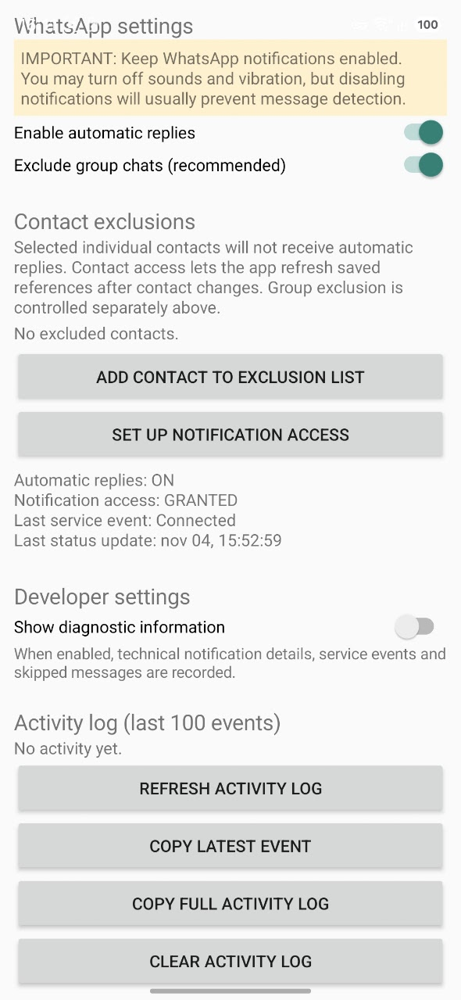

# NotHere

**Automatically let your WhatsApp contacts know you've moved to Signal.**

NotHere is an Android app that automatically replies to incoming WhatsApp messages with a customizable message, letting people know they can reach you on Signal instead.

## Download

**[Download the latest NotHere release](https://github.com/skatespeare/NotHere/releases/latest)**

Download the APK file and install it on your Android device.

## Features

- **Custom automatic replies** – Set your own message.
- **Configurable reply frequency** – Reply to every message, every 30 minutes or every 24 hours.
- **Contact exclusions** – Prevent automatic replies to selected individual contacts.
- **Group chat exclusion** – Automatically skip group conversations.
- **Activity log** – See sent replies and skipped messages.
- **Duplicate detection** – Prevent repeated replies to the same notification.
- **Notification-based integration** – Uses WhatsApp notification reply actions.

## Screenshots

### Main screen

### Settings and activity log

## Installation

1. Download the latest APK from the [Releases page](https://github.com/YOUR_USERNAME/NotHere/releases/latest).
2. Open the downloaded APK on your Android device.
3. Allow installation from this source if Android asks for permission.
4. Install NotHere.
5. Grant notification access to enable automatic replies.
6. Grant contacts permission if you want to manage individual contact exclusions.

## Important: WhatsApp notifications

WhatsApp notifications must remain enabled for NotHere to detect incoming messages.

You can turn off notification sounds and vibration, but disabling notifications will usually prevent message detection.

## How it works

NotHere listens for incoming WhatsApp message notifications and uses the available notification reply action to send an automatic response.

The app does not read your full WhatsApp message history or send messages independently of the notification system.

## Privacy

- Notification processing takes place locally on your Android device.
- Contact exclusions are stored locally.
- NotHere does not require a NotHere account.

## Requirements

- Android 8.0 (API 26) or later.
- WhatsApp installed.
- Notification access permission.
- Contacts permission for individual contact exclusions.

## Development

Built with Kotlin using Android Studio.

## License

NotHere is open source and available under the [MIT License](LICENSE).

## Project status

Personal Android project under active development.
